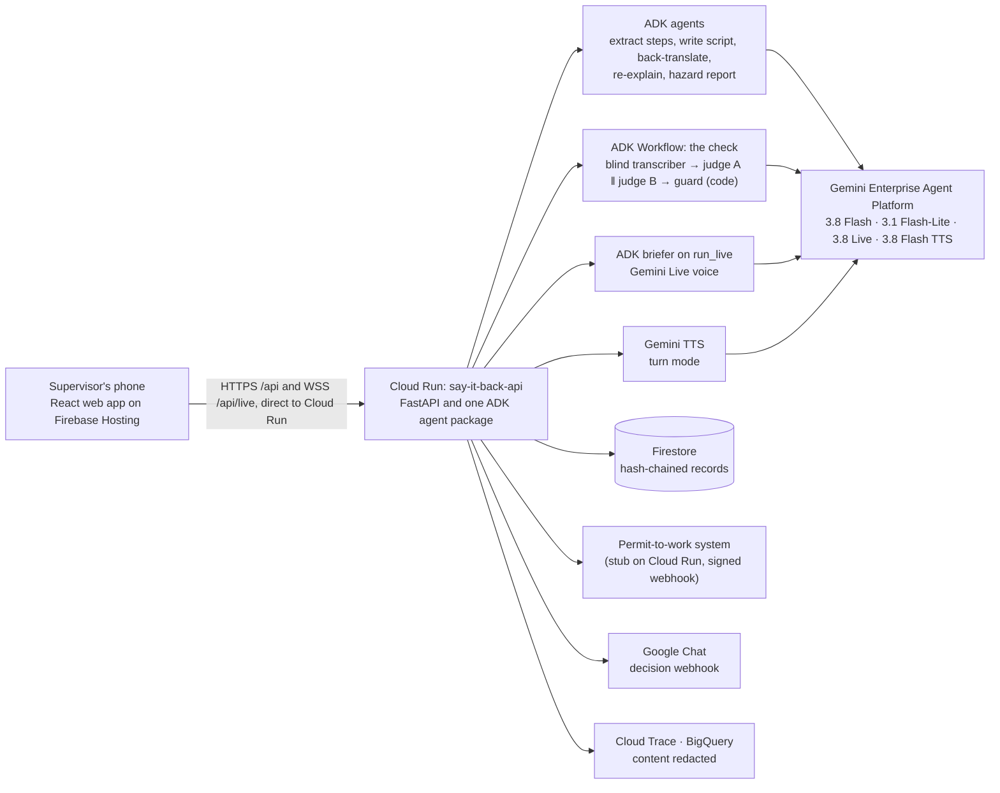

# Say It Back

[](https://github.com/Hari-code-clips/say-it-back/actions/workflows/ci.yml)


**Read-back, in the worker's own language, before a high-risk permit-to-work is released.** Each worker named on the permit says the steps back, one worker at a time (crews of 1 to 6); the permit stays held until every one of them has been checked and the supervisor says Go. It is built for the task-specific permit briefing, not the daily toolbox talk for a large group: a real round takes about 2 minutes per worker. A site supervisor gives a safety instruction once. The worker hears it in their own language and says back, out loud, what they will do. Gemini checks the answer against the task's critical steps and shows the supervisor, step by step, what was said back, what was missed and what was said wrong. The supervisor decides whether work starts. The AI informs that decision and never makes it.

**Why this is Future of Work and Enterprise Productivity.** It works beside the site's existing permit-to-work system: the permit's procedure knowledge reaches each frontline worker in their own language, and the evidence comes back to the decision-maker per step, in the worker's own words, instead of a signature on the permit. Singapore's approved Code of Practice for Working Safely at Heights says that all workers covered under the permit are identified and briefed on the hazards and control measures before work starts (s 4.3.4), that information is given in a form all workers can understand, including languages other than English (s 3.8.3), and that the permit is communicated so that everyone involved understands the hazards and risk controls. The permit-to-work provisions we reviewed do not prescribe an individual, open-recall check of each worker before the permit is released; that check is what Say It Back adds. The supervisor gets decision support, not a decision ("AI should inform decisions, not make them"). The re-explanation covers only the steps that were missed, and the record, with how long the briefing took, flows into the site's permit-to-work system.

**Quiz versus open recall.** Briefing apps already ask comprehension questions after a toolbox talk (TBT Go, for one, argues that a signature alone does not show understanding), so checking is not new. What differs is the kind of answer. A multiple-choice quiz lets the worker choose from the options it shows, and the options are cues. Here the worker has to produce the answer: an open question, no choices, said in their own words and language. The supervisor then sees, for each critical step, the worker's own words (with a translation) beside the verdict, not a score. We do not claim this leads to better safety outcomes than a quiz; that would need a comparative study.

## For evaluators: two minutes, no login, no Tamil needed

**Deployed app:** [say-it-back-cup.web.app](https://say-it-back-cup.web.app) · **Demo video:** [link coming]

Use Chrome or Safari on a phone or a laptop. Browsers inside apps (LinkedIn, WhatsApp, WeChat) usually cannot use the microphone; the page says so. Each Gemini step usually takes 15 to 40 seconds, and a counter shows the time.

**Shortest path: *Run the 90-second judge demo*** (first screen, under the two buttons). It sets up the lead case for you (Singapore, *Crane lift: the lifting zone*, English → Tamil, the sample instruction) and finds the critical steps. You confirm the steps and approve the script, as a supervisor would; the handover then opens with *Use stored sample answers* already ticked, so *Give phone to worker*, then *Start* on the worker's screen, and the stored Tamil answers play by themselves. Hold *Supervisor: hold to continue* to see the result: the step the worker got wrong in the right words. About six taps, plus the model's waits.

1. **Try a sample answer** (first screen). Pick one of the stored answers, including a fluent answer that uses the right words for the wrong action ("I'll stand under the load and hold it straight"). Press *Try it*: the real check runs on Gemini (a blind transcript, two judges on two different models, then a code guard) and shows each step's verdict next to the label a person gave it.
2. **Start a briefing** for the whole loop:
   1. Keep the defaults (Singapore, English → Tamil, *Crane lift: the lifting zone*). Optionally tick *For a permit-to-work*: permit number `PTW-123`, *2* workers on the permit, this briefing is for worker *1*. Then tap *Use the sample instruction*.
   2. Gemini lists the critical steps and flags one you didn't say, taken from the site's procedure ("From the SOP, not in your instruction").
   3. Confirm the steps, read the English back-translation of the Tamil script, and tap *Approve script*.
   4. On the handover screen, tick ***Use stored sample answers for this round*** (marked "Synthetic voice"), then *Give phone to worker*. A stored Tamil answer plays into each question's answer window, in this round and in the re-explain round, so nobody needs to speak Tamil; the note under the box says which questions have one, and if it names only some, answer the others yourself or tap Done. From here the screen is in Tamil only, for the worker; the supervisor's controls are press-and-hold (1.5 s).
   5. When the worker screen says to give the phone back, hold *Supervisor: hold to continue*. Read the result, re-explain the open steps, and try *Report a problem* on the worker screen. Go stays locked until you acknowledge it.
   6. Decide. A step said back only by a stored sample answer counts as open (the worker has not said it), so Go asks for a reason. The record is hash-chained and verified on screen, and shows how long the briefing took. On a permit, *Brief worker 2 of 2* starts the next worker with the same task and permit; the permit board (the permit-to-work system's stand-in) keeps the permit **held** until every worker on it has a Go, then shows it **released**, one row per worker with its record hash and no names.
3. **Eval** shows how the checker scores on 99 labelled answers in seven worker languages, 11 of them recorded by a team member. The headline is false passes: a missed or wrong step rated "Got it". Beside it: how often a correct answer is passed (an over-cautious checker fails the bar too), the same numbers on 14 answers for two tasks no prompt or demo was tuned on (confined-space entry and fragile roofs), the voices split three ways, and a keyword baseline scored on the same answers. **Paid run of 17 Oct 2026 (prompt 2026-10-16.12, guard rule 1 v0.5.3, judges at `low`): 0 false passes in 92 risky step ratings (rule-of-three bound 3/92 ≈ 3.3%, which assumes the 92 independent; they are not, and the set is labelled by the team); exact 86.6%; 82 of 87 correct answers rated "Got it"; on the held-out tasks 0 false passes in 15 risky ratings (bound 20.0%, n = 15; exact 92.6%); by voice, Gemini TTS 0 of 68, Sarvam 0 of 8, recorded human 0 of 16 (one speaker, quiet room); keyword baseline 6 false passes, keyword + negation 1. Demo stability: the lead demo's 6 stored answers, 10 runs each, gave the same label every time and no false pass.** **Human voices, 18 Oct (same prompt and models): 35 more consented recordings from four more speakers (Tamil with real rain behind it, Hindi, Bengali, Odia) gave 0 false passes in 44 risky ratings; a re-run of the first speaker's 11 gave 1 of 16 (a panel answer that tests with the tester before opening the panel was rated "Got it", where the 17 Oct run said "Ask again"); all 46 recordings, 1 of 60, exact 85.7%.** Most voices in the main set are synthetic and judged by Gemini, which flatters any checker; workers' own speech on a live site is the next step. Full reports: [eval/reports/latest.md](eval/reports/latest.md), [eval/reports/recorded/latest.md](eval/reports/recorded/latest.md).

Everything is synthetic: tasks, procedures and voices. No real worker data.

## How it fits together



Firebase Hosting serves the web app as static files. The browser calls the Cloud Run service directly, for the API and for the Live WebSocket, so every request reaches the service through the same hops and the per-address limits can trust `X-Forwarded-For` read from the right. Each browser sends a random device key (`X-SIB-Device`) that owns its briefings; there are no accounts.

## What makes the check hard to fool

- **Blind transcription.** The transcriber never sees the steps, so it can't "hear" what it expects.
- **Two judges, two models.** Judge A hears the audio, judge B reads only the transcript, on a different Gemini model. If they disagree the step is "Ask again" (a contradiction in either stays "Wrong"), never a pass.
- **No test answer in the prompts.** The judges' examples come from forklift traffic and chemical decanting, domains in neither the demo tasks nor the evaluation set, and a test fails if a prompt shares a phrase with any test answer. The hard case is caught by reasoning, not by having seen it.
- **Quotes that are real evidence.** A quoted phrase must appear, in order, in what the worker actually said, and a "Got it" quote must be more than a word or two. An unsafe statement stays "Wrong" even if the worker is silent on a later question.
- **A code guard decides.** A step counts as said back only if both judges agree, the quoted words are really in the transcript, the language is right by Unicode script, and the confidence is high. Any doubt becomes "Ask again".
- **The voice can't improvise unnoticed.** Gemini Live reads only the approved script and never sees the steps. Afterwards code compares what it said with the script, counting negations and numbers. A dropped "not" turns the affected steps into "Ask again", even though it barely changes text similarity.
- **People stay in charge.** The supervisor confirms the steps, approves the script and makes the decision. The worker can report a problem, which locks Go until the supervisor acknowledges it.
- **A record that shows edits.** Every state change is a link in a SHA-256 chain that binds the steps, scripts, ratings and decision. The decision's chain head is sent to the permit-to-work system, which anchors it outside the store.

## Built on Google

| Google product | Role in Say It Back |
|---|---|
| Gemini 3.8 Flash | Extract steps, write script, back-translate, blind-transcribe, judge A, re-explain, hazard report |
| Gemini 3.1 Flash-Lite | Judge B, a second model so the two judges' mistakes are less correlated |
| Gemini 3.8 Live | Speaks the approved script in the worker's language and listens |
| Gemini 3.8 Flash TTS | Turn-mode voice; the synthetic evaluation set |
| ADK 2.11 (Python) | Every agent; the check as an ADK 2 `Workflow` graph (fan-out judges, `JoinNode`, guard `FunctionNode`); Live through `run_live`; App with plugins; `adk web` over the same agents |
| Gemini Enterprise Agent Platform | The Gemini backend in the cloud, on the service account |
| Cloud Run | The ADK service (REST and WebSocket) and the permit-to-work stub |
| Firebase Hosting | The web app (static, strict CSP), plus deny-all Firestore client rules |
| Firestore | Hash-chained briefing records and the daily cap |
| Cloud Trace, BigQuery | Per-agent spans; agent analytics with transcripts and audio redacted (switched on by configuration) |
| Google Chat | Go/No-go posted to the site's space (switched on by configuration) |
| Secret Manager | The webhook signing secret; a Developer API key only if one model needs it |

## Run it locally

The offline tests need no Gemini key and make no network calls. Run each block from the repository root.

```bash
# Backend: install, lint, offline tests
(cd backend && uv sync && uv run ruff check . && uv run pytest -q)

# Web: tests, typecheck, and the whole app with no backend and no Gemini
(cd web && npm ci && npm test && npm run typecheck)
(cd web && npm run dev:mock)          # http://localhost:5173

# Eval: offline tests for the evaluation set and runner
(cd eval && uv sync && uv run pytest -q)

# Permit-to-work stub
(cd integrations/ptw-stub && uv sync && uv run pytest -q)
```

Against real Gemini: `cd backend && GOOGLE_API_KEY=... uv run uvicorn sayitback.main:app --port 8080`, then `cd web && npm run dev`, which proxies `/api` to port 8080. For Agent Platform instead of a key, see "Choosing the Gemini backend" in [backend/README.md](backend/README.md).

## Documentation

- [Architecture](docs/ARCHITECTURE.md): system, the flow of one briefing, design decisions and configuration.
- [API contract](docs/API.md): endpoints, types, the state machine, guard rules, the Live protocol and the record chain.
- [Deploy to Google Cloud](deploy/README.md): the scripts, their order, costs, verification and rollback.
- [Evaluation](eval/README.md) and [the paid run](eval/RUN_PAID.md).

## Guardrails

- The tool never approves work. Only the supervisor's decision is recorded, and Go is refused while a worker's hazard report is unacknowledged.
- A step is never rated as said back when the judges disagree, the quote is not in the transcript, the answer is in the wrong language, there was no speech, the confidence is low, or the voice may have said something other than the approved script.
- The voice briefer never receives steps, essentials or ratings, and the browser can send only listed cues and audio.
- No worker name, ID, score or history is stored. Audio is discarded unless `SIB_KEEP_AUDIO=true`. The record names what was checked, never grades the person, and is not for discipline or references.

## License

Apache License 2.0. See [LICENSE](LICENSE). Copyright 2026 Code in the Stone.
