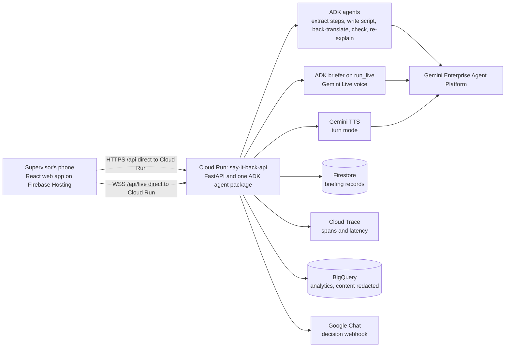

# Say It Back

[](https://github.com/OWNER/say-it-back/actions/workflows/ci.yml)


Say It Back is a prototype for the pre-task safety briefing. The supervisor's instruction is spoken to the worker in the worker's own language. The worker explains it back, out loud. Gemini checks the answer against the task's critical steps and shows the supervisor, in the supervisor's language, which step was missed. The supervisor decides whether the work starts. The AI informs that decision and never makes it.

**Deployed app:** coming. **Demo video:** coming.

## How it fits together



Firebase Hosting serves the web app as static files. The browser calls the Cloud Run service directly, for the API and for the Live WebSocket, so every request reaches the service through the same hops and the per-address limits can trust `X-Forwarded-For` read from the right. Each browser sends a random device key (`X-SIB-Device`) that owns its briefings; there are no accounts.

## Built on Google

| Google product | Role in Say It Back | Status (13 Oct) |
|---|---|---|
| Gemini 3.8 Flash | Extract steps, write script, back-translate, blind-transcribe, two judges, re-explain | Verified by probe (Developer API) |
| Gemini 3.8 Live | Speaks the approved script in the worker's language and listens | Verified by probe, raw and through ADK `run_live` |
| Gemini 3.8 Flash TTS | Turn-mode voice; synthetic evaluation set | Verified by probe |
| ADK 2.11 (Python) | Every agent; the check as an ADK 2 `Workflow` graph (fan-out judges, `JoinNode`, guard `FunctionNode`); Live through `run_live`; App with plugins; `adk web` dev UI over the same agents | `run_live` and HITL verified by probe |
| Gemini Enterprise Agent Platform | Gemini backend in the cloud on the service account | Verify in the hackathon project (Live: US/EU endpoints only) |
| Cloud Run | Hosts the ADK service, REST plus WebSocket | Deploy pending |
| Firebase Hosting | Serves the web app (static, strict CSP); deploys deny-all Firestore client rules | Deploy pending |
| Firestore | Briefing records | Fake-tested; deploy pending |
| Cloud Trace | Per-agent spans and latency through ADK's OpenTelemetry | Env-gated |
| BigQuery | Agent event analytics through ADK's plugin; transcripts and audio redacted | Env-gated |
| Google Chat | Go/No-go decisions posted to the site's space by incoming webhook | Env-gated |
| Secret Manager | Only if a Developer API key is still needed in the cloud (e.g. TTS) | Conditional |
| Cloud Build, Artifact Registry | Used by `gcloud run deploy --source` | Deploy pending |
| Google Fonts, Material Design 3 | Noto for every script, Material Symbols icons, M3 colour tokens | Web build |

## Quick start

Run these from the repository root. The offline tests need no Gemini key.

```bash
# Backend: install, lint, offline tests
cd backend && uv sync && uv run ruff check . && uv run pytest -q

# Web: Vite dev server in mock mode (API calls mocked)
cd web && npm ci && npm run dev:mock

# Eval: offline tests for the evaluation set and runner
cd eval && uv sync && uv run pytest -q
```

## Documentation

- [Architecture](docs/ARCHITECTURE.md): system diagram, the flow of one briefing, design decisions and configuration.
- [API contract](docs/API.md): endpoints, types, the state machine and the Live protocol.
- [Deploy to Google Cloud](deploy/README.md): the scripts, their order, costs, verification and rollback.

## Guardrails

- The tool never approves work. Only the supervisor's decision is recorded.
- `covered` is never returned when the judges disagree, the quote is not in the transcript, the answer is in the wrong language, there was no speech, or the confidence is low.
- The voice briefer never receives steps, essentials or ratings, and the browser can send only listed cues and audio.
- No worker name, ID, score or history is stored. Audio is discarded unless `SIB_KEEP_AUDIO=true`.

## License

Apache License 2.0. See [LICENSE](LICENSE). Copyright 2026 Say It Back team.
